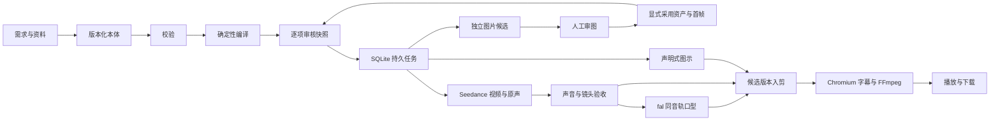

# v0.4.1 生产性测试与恢复加固（2026-10-13）

- 新增 [生产性测试规程](PRODUCTION-TESTING.md)，将本机回归、隔离Linux候选、公网只读检查、真实模型和正式升级分别验收。详细结果以本版本验收附件为准，不继承旧版“通过”。
- 修复两个实证问题：restore替换中断导致启动空库；媒体探测/提取期间取消被完成状态覆盖。数据库还原加入持久journal、启动阻断和显式回滚；不要删除journal强行启动。
- `tests/process-recovery.test.ts` 用真实子进程与loopback HTTP模拟供应商，验证提交受理不明、续查与下载恢复，无实际模型请求。`tests/maintenance.test.ts`覆盖还原/回滚过程真实SIGKILL。
- CI新增 `editor-container`，实际构建固定编辑器镜像并在无凭据、无网络环境验证Linux沙箱；不能把这项测试解释为重新调用了Claude或重新生成影片。

# v0.4.0 完整模块交接（2026-10-13，历史交付）

- 用户认可当前工作流，更新完整应用源包与私有仓库；不重部署、不新生成。本版整合此前已提交的火山口型和独立Docker后期能力，补全跨Mac的制作方法、空白交接单及确定性打包工具。
- 从 [声音先行框图](VOICE-FIRST-WORKFLOW.md) 开始，按需求／本体／脚本、声音批准、同轨口型、冻结、后期、独立检查、审片推进。**目前由操作者交接应用与编辑器**，未新增主应用公共编辑API。
- `ops/editor/` 与应用分别使用Docker配置和持久目录。原生9Router请求 `ezr/claude-opus-5-5`；编辑器只能读取声明哈希的输入，通过隔离MCP执行程序。构建、部署、任务提交、主观审片是分开的步骤，见 [编辑器指南](EDITOR-WORKER.md)。
- 修正根Compose遗漏 `VIDEO_MODEL`：新部署明确选择Veo时与原生开发一致。诊断工具显示实际配置的视频模型。该修复不更改历史任务的冻结供应商/参数，不解除审核门禁，不执行生成。
- 完整包使用 `scripts/package-source.py` 读取某个Git提交的全部合法tracked blobs，逐文件记录SHA；参考 [发布检查](SOURCE-RELEASE.md)。包含已有授权AI图例，不带原始医生照片、原始资料、真实影片和私有运行记录。
- 主应用CI继续验证测试、前端、主Docker构建和卷恢复；编辑器CI目前只有离线单元/协议/构建输入检查，真实Linux镜像与沙箱运行来自已记录的2026-10-13实测。没有宣称Apple Silicon Docker完成实机验收。
- 新版本最终提交、ZIP哈希、全新解压与GitHub CI结果以同版本Release外置 `ACCEPTANCE.json` 为准。验收后的生产应用版本不因源码Release而变化。

# 火山 OmniHuman 1.5 接入（2026-10-11）

- 新建口型任务可通过 `LIPSYNC_PROVIDER=volcano-omnihuman` 选择火山；默认仍为 `fal`。服务端凭据为 `VOLCENGINE_ACCESS_KEY_ID`、`VOLCENGINE_SECRET_ACCESS_KEY`，需在火山即梦视觉服务开通 OmniHuman 1.5。方舟普通 API Key 不是这里的 AK/SK。
- 固定接口为 `https://visual.volcengineapi.com`，提交 `CVSubmitTask`、查询 `CVGetResult`，`Version=2022-08-31`、签名 region `cn-north-1`、service `cv`、`req_key=jimeng_realman_avatar_picture_omni_v15`。不与 API Explorer 的另一组2024接口参数混用。请求 `output_resolution=1080`、`pe_fast_mode=false`、`seed=-1`；只发送照片、原音轨与提示词，工程 fps／像素宽高不声称已被模型使用。当前固定接口文档限制音轨小于60秒，建议15秒内，最终成片由公共后期流程统一时基。[官方参数](https://docs.volcengine.com/docs/JimengAI/CallStep3VideoGeneration?lang=zh)、[官方签名示例](https://github.com/volcengine/volc-openapi-demos/tree/main/signature)。
- 火山输入采用 URL；当前只复用已有公开审稿白名单中的图片及已完成声音产物，不新增文件公开接口。`PUBLIC_BASE_URL` 必须是公网 HTTPS，`STORYFLOW_PUBLIC_REVIEW_API_BASE` 保留实际代理前缀；`STORYFLOW_PUBLIC_REVIEW_PROJECTS` 中的工程才可使用。私有原照、未被公开摘要引用的上传文件不会自动发布。私有项目暂待有明确授权的短期签名媒体方案，不能为生成而放开整库。
- 提交前分别匿名 GET 两个输入并核对其字节 SHA-256，再保存持久提交意图，最后仅 POST 一次。回执记录输入 ID／哈希／URL、实际请求参数及 API 身份；没有独立模型回传时 `actualModel:null`。签名请求头及 AK/SK 不写回执、日志、公开摘要或导出包。
- 新任务的 `lipsyncSpec` 冻结供应商与协议。升级前没有该字段的排队口型任务继续按 fal 处理；已有 fal／火山任务始终按原 handle 查询，不受当前默认供应商切换影响。切换配置不迁移旧任务、不批准音轨、不创建新任务。
- 断线、5xx、受理响应不可读或缺少有效 task ID 保留受理不明，不自动重投；官方明确业务拒绝保留脱敏错误码。已受理任务查询或下载失败复用原 ID；`not_found/expired` 不自动新提交。下载视频不携带火山签名或其他模型凭据。现有单进程串行队列与同一已审音轨绑定保持不变。
- 入口：`server/volcano-visual.ts`（受限签名／协议快照）、`server/providers.ts`（提交／续查）、`server/provider-media.ts`（公开范围复用）。真实账户权限、额度、生成效果与口型验收和本地模拟测试分别记录；增加适配不代表已调用或生成影片。

# 显式声音裁剪（当前开发）

- 管理员可调用 `POST /api/artifacts/:id/voice-trims`，提交 `{baseRevision,fileId,fileSha256,sourceHash,startMs,endMs,idempotencyKey}`。`id` 必须是当前修订的 voice 候选；起止时间是用户明确选择的整数毫秒，区间不得超出原声，成品不得长于所属镜头。没有默认裁剪区间，也不自动按镜头截断。
- FFmpeg 以原采样率按样本裁剪并输出 PCM WAV，不改变语速；校验实际时长后才保存。原声、原片和旧候选保留；新 voice 候选默认未通过，需要重新听审。元数据记录父候选、父音轨 SHA-256、原生成哈希、毫秒及样本区间。
- 裁剪是本地操作，不调用视频或声音模型。保存一条 `input.operation=voice-trim` 的已完成本地 voice 任务和新候选，供原公开制作视图播放；任务在同一事务中完成，模型调度器不会执行它。相同幂等键和参数在并发、响应丢失或重启后返回同一候选；输入变更须使用新键。
- 公开声音卡提供手动起止秒数与“裁剪为新声音候选”。裁剪不会代替人工通过；新声音通过后，旧声音及绑定不同音轨的口型按既有审核规则失效。**已排队的旧口型任务不会静默换声**：应明确取消未受理的旧口型任务，再按当前已审核声音重新创建该医生镜头的口型任务；已受理任务保留原音轨绑定。
- 此接口挂在现有管理员会话和 Origin 检查之后。需要从云动审稿页使用时，反向代理仅追加该路径的 POST 白名单，不开放整个项目 API。公开摘要只增加声音时长、镜头时长与裁剪父候选/区间，不暴露本机路径或源文件列表。
- 验证入口：`tests/voice-trims.test.ts` 使用固定8秒 PCM，明确裁取1.5–6.5秒，逐样本核对结果与源段完全一致；覆盖超长、越界、旧修订、哈希变化、幂等恢复、听审失效及0供应商调用。浏览器测试覆盖不预选区间、过长拒绝、响应丢失重试沿用幂等键、原图片草稿保持及手机布局。真实台词是否完整、语义断点与听感仍由审核人验收。

# v0.3.3 当前开发入口

- 修正 fal OmniHuman 1.5 的队列查询路径。提交保留 `/fal-ai/bytedance/omnihuman/v1.5`；状态/结果按官方 SDK 使用 `/fal-ai/bytedance/requests/<id>[/status]`。回执 URL 精确匹配既有供应商 origin、owner/app、任务 ID 与操作，避免错误回退或跨任务请求。
- 已受理任务恢复只查询原 ID，不重新提交。此版本没有改变 Seedance、审核批准或素材绑定逻辑，也不自动创建新生成任务。
- `/healthz` 和 `/api/config` 的版本来自同一安装包 `package.json`；读取路径相对服务端模块，不依赖启动目录。生产验收应同时核对两个端点与镜像中安装包版本。
- Node 22.23.1 下 `npm run check` 通过：TypeScript、工作台/审稿双构建和127项核心测试。fal fixture 使用合成 ID，验证真实协议格式；它不是已完成的真实模型任务。详细范围见 [验收记录](VERIFICATION.md)。
- 运行配置仍仅需服务端 `FAL_KEY`；模型和官方队列地址固定，无需新配置项或数据库迁移。按已授权范围使用 API 权限，密钥不进入源码、浏览器、日志或工程包。只读价格查询可验证认证；真实生成、声音和口型必须另行按实际任务验收。
- 发布时保留私有环境与持久卷，先核对已有队列，再仅重建本应用。配置 Key 可能解除已有任务的“待配置”，不能把重新加载配置当作新的批量生成授权。源码发布、生产上线与真实模型完成分别记录。

# v0.3.2 保留能力

- 批量采用：`POST /api/projects/:id/production-images/adopt`，body 为 `{baseRevision,idempotencyKey,items:[{artifactId,sha256}]}`。只接受当前展示、当前有效且已批准的图片，核对真实字节；绑定写入一次修订，审核新制作快照后再调用既有 `/runs`。
- `metadata.productionAdoption` 记录绑定修订及采用条件，原 `sourceHash` 和生成回执保持不变。有效采用必须匹配同工程持久 action；工程 ZIP 中的记录仅作历史，不继承授权，完整私有备份恢复则保留该 action。真实父图、脚本或身份变化仍使候选过期；不以重写来源绕过审核。
- 公开制作视图：`GET /api/public-review/:id/production`；已登录管理员经 `POST /api/public-review/:id/artifacts/:artifactId/review` 提交 `{accepted,sourceHash,fileSha256,note}`。只处理该公开工程、当前产物的审核，不创建额外付费任务。
- 候选视频/声音使用原 `files/:fileId` 白名单下载，支持 Range；页面 CSP 限制 `media-src 'self'`。反向代理还需允许上述两个路径，不能开放整个项目 API。
- 真实视频执行依赖供应商配置、素材批准和前镜产物审核。没有凭据、缺图、受理不明、待听审都不是“生成成功”。浏览器草稿与服务器正式审核分别保留。

# v0.3 历史开发入口

新增能力和操作语义以 [REVIEW-WORKFLOW-v0.3.md](REVIEW-WORKFLOW-v0.3.md) 为准：图片内联审核、意见事务、返修任务、统一身份门禁和可配置在线审稿。下文 v0.2 的本地导出意见说明为历史实现，不再是主操作路径。

数据库已升级到 `user_version=2`，自动执行 `002-review-submissions.sql`，保存逐次意见与对应返修任务。备份工具兼容版本1/2；升级前保留完整备份，旧版本不能直接打开新版活动数据库。工程ZIP保留审核历史作为只读证据，不重放任务或批准。

# 开发交接

## 架构

前端是 React 19／TypeScript／Vite，后端 Node 22／Express。业务数据使用 SQLite WAL，二进制媒体写入按 SHA-256 命名的内容目录。单进程串行处理重任务，不引入 Redis、图数据库、Blender 或旧服务依赖。

| 路径 | 职责 |
|---|---|
| `shared/types.ts`、`shared/ontology.ts` | 类型、运行时校验、规范哈希、依赖传播与编译 |
| `server/store.ts` | SQLite 表初始化、版本、审核、幂等记录、媒体和产物 |
| `server/jobs.ts` | 持久任务、提交意图、受理不明、恢复、依赖审核门禁 |
| `server/providers.ts` | 图片／Opus／Seedance／fal 网络边界与实际参考回执 |
| `server/media.ts`、`render-overlay.ts` | 同一帧时钟、图示、字幕、音轨、精确媒体合成 |
| `server/ingest.ts`、`archive.ts` | 资料解析、受限 ZIP、工程迁移与只读审稿导出 |
| `server/app.ts`、`main.ts` | 单管理员 API、Range、静态前端与生命周期 |
| `src/` | 四阶段编辑、进行中的项目、资产审图、制作图、审核和候选播放 |
| `src/review/`、`server/public-review.ts` | 工作台与公开快照共用审图组件、安全视图模型及静态包 |

v0.2 图片字段添加在现有类型化 JSON 修订与产物数据内，兼容没有这些字段的 v0.1 工程，不靠修改旧数据来伪造生成来源。数据库仍为 `PRAGMA user_version=1`，首个迁移在 `server/migrations/001-init.sql`；全新启动即创建，也可停机运行 `npm run db:init`。添加 schema 版本时必须明确迁移，先备份，不能在启动时猜测或覆盖旧结构。工程修订不可原地覆盖，审核记录按 `(project,target,hash)` 保存。

## 恢复语义

- 未提交的任务：可以排队执行。
- 已持久化提交意图，尚无供应商 ID：重启后进入受理不明；禁止自动 POST。
- 有供应商 ID：始终复用原 ID 查询。下载或查询失败的重试不重发生成请求。
- 受理不明：由管理员到原供应商查找任务 ID，再在任务详情核对恢复；文本展开没有异步 ID 时保留不明记录，显式新提交前先核对账单与结果。
- 下游任务：等待前置任务成功并且产物人工通过。已审声音哈希绑定口型；撤回审核会阻止后续制作和合成。
- 新脚本生成条件发生变化：旧任务快照不能作为新内容继续提交。字幕修改保留原生成哈希，但旧的字幕/后期批准失效。
- Opus 返回时工程已经被用户修改：建议保留在任务中，由管理员明确应用，不覆盖当前草稿。

## 目前能力边界

运行的是结构化本体与可信执行器。没有 3D 导演台、骨骼动画或 DLSS；这些不属于本次独立医学审稿项目。动画图示支持文字、矩形、圆、箭头与淡入淡出，不执行模型返回的任意代码。风格丰富度可以在不放开代码执行的前提下扩展类型。

PDF/DOCX 提取文字并保留原文件，图片不自动转成医学证据；不提供自动 OCR。外部参考检索提供来源条目，下载和使用许可需人工核对后导入绑定。工作台预览、资料与下载默认要求管理员登录；v0.2 通过独立的安全视图模型导出只读发布快照，不公开管理员 API。公开包只带获准共享的图片、必要来源和审稿数据，不包含整个工程、原照、任务回执或私人路径。

独立应用生产域名仅提供配置模板。v0.2 专项已经包含真实资产图片与 Opus 声明式图示，所有候选仍需人工定稿；Seedance、fal、真实医生声音/嘴形和完整医学影片仍待单独授权后的验收。此前项目的视频不作为新应用真实生成成功的证据。

## v0.2 图片候选与恢复

- `Job.kind` 和 `Artifact.kind` 新增 `image`。产物按 `assetId` 或 `shotId` 归属，保留请求/回传模型、真实父图 ID 与 SHA-256、生成条件哈希以及审核记录。
- 资产 `previewImage` 和镜头 `reviewImage` 用于审图；镜头 `firstFrameImage` 与资产 `fileId/sha256` 用于制作。预览选择不改视频生成哈希，显式制作选择要求当前候选已人工通过。
- `Project.imageTargetHashes` 供前端判断条件版本，`imageCandidateCurrent` 同时检查父图递归是否仍然有效。服务器在审批与采用时再次校验；前端状态不能替代服务端门禁。
- UI 的“实际发送的参考图”多选显式传 `referenceAssetIds`，默认选中镜头关联且有真实文件的资产，可取消。待审父图会标明状态，不自动变成已批准输入；补充要求与当前本体约束合并发送。
- OpenAI 兼容图片服务通过 `IMAGE_BASE_URL`、`IMAGE_API_KEY`、`IMAGE_MODEL` 单独配置。有参考图走 multipart `images/edits`，无图走 `images/generations`；每次 `n=1`，不自动模型回退或重复 POST。
- 提交意图先持久化，收到原始响应后保存收据再解析/下载。重启时已有收据可继续落盘；没有可确认回执的提交转入 `uncertain`，不得自动重投。下载失败不意味着可以重新生图。
- `imageAttempt` 是外部生成批次的只读失败/阻塞记录，不是当前应用真实执行的 `Job`。它说明是否已提交、失败代码及阻塞父图，不生成伪进度。

本轮 `A-SYM-FOAM` 已被供应商政策拒绝，`S06` 因依赖未提交。52是目标与调用上限，不是交付成功数；当前实际50张候选（31项资产＋19镜首帧），人工定稿0张；其中16项有技术返修建议，详见 `docs/evidence/IMAGE-GENERATION-v0.2.md`。模型响应未明确返回实际模型时保留 `null`，不能把 `gpt-image-2` 请求名当作上游身份。

## 同一审图界面与跨 Mac 意见

`npm run build` 同时生成工作台和 `dist-review` 的静态审稿 JS/CSS。共享的 `ReviewPresentation` 与 `projectSnapshot` 提供卡片、原图、候选比较、关联资产、分镜和真实依赖框图；卡片与框图优先加载缩略图，弹窗再加载完整图，技术返修标记与人工待审分开呈现；公开包装层只增加锚点导航、本地草稿与下载，不另写一套图片展示逻辑。

- `GET /api/projects/:id/review.html` 在管理员会话中预览当前固定快照；它不是匿名可写服务。
- 项目顶栏“导出公开审稿包”使用 `GET /api/projects/:id/review-snapshot` 下载可单独托管的 ZIP，内有 `index.html`、按哈希命名的图片与 `public-manifest.json`。发布前核对清单；没有构建交互组件时明确拒绝完整交互导出。
- 公网页面只把意见保存在浏览器 localStorage，可下载 JSON/Markdown。草稿里的“通过”不会改变冻结快照的正式批准数，也不会发送模型请求。
- 在新 Mac 导入工程后，再从“审核 → 导入意见”载入 JSON。保留来源工程、修订、快照、目标哈希和所审候选图片哈希；区分当前匹配、仅图片匹配、历史内容。意见导入为待人工核对，不自动覆盖正式批准。
- “采用意见为当前待审”只把文字带入当前对象；最终批准仍要在工作台明确执行。因新电脑生成了不同工程 ID，不应丢弃来源或把旧意见冒充新审核。

公开快照与完整工程 ZIP 是不同的交付物。完整工程/备份可能包含私人资料，不能拿来替代公开审稿包。既有云动静态页的更新不代表 `storyflow.yundongyl.cn` 应用已部署。

## 交互设计说明

首页围绕当前影片、真实完成证据、下一步和阻塞项组织，行动卡直接进入对应素材或镜头；四阶段入口保持可见。设计只借鉴 SAI 养成系方法中的持续承接和行动卡原则，视觉采用浅色靛紫、轻微渐变、统一圆角与减少动效支持。不打包或引用内部文档原文、品牌图稿、人物资料，也不增加关系积分或强制活跃机制。

## 下次开发建议

1. 从 GitHub 或源码 ZIP 开始，先运行 `npm ci`、`npm run doctor`、`npm run check`、`npm run test:ui`。
2. 创建独立数据目录；不要用旧视频工作台的数据库和服务凭据作为默认配置。
3. 先逐张审核已有候选及缺口。图片返修、短声音/视频和口型属于新的制作动作，确认授权与调用上限后再执行，核对真实回执和账单。
4. 导入获准使用的医生照片与资料，逐件检查来源及症状素材，审核后再制作完整 60 秒实片。
5. 分别记录代码通过、接口实测、医学审查、口型听感、公网部署验收；不要合并成一个“全部通过”。

运行命令和备份工具见部署文档。所有新代码应添加有意义的边界测试，尤其是新供应商的受理不明、重复请求与重启恢复。
