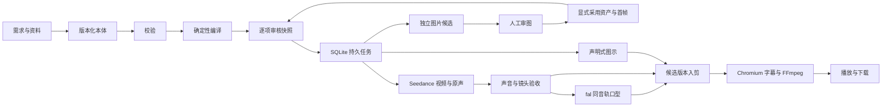

# 开发交接

## 架构

前端是 React 19／TypeScript／Vite，后端 Node 22／Express。业务数据使用 SQLite WAL，二进制媒体写入按 SHA-256 命名的内容目录。单进程串行处理重任务，不引入 Redis、图数据库、Blender 或旧服务依赖。

| 路径 | 职责 |
|---|---|
| `shared/types.ts`、`shared/ontology.ts` | 类型、运行时校验、规范哈希、依赖传播与编译 |
| `server/store.ts` | SQLite 表初始化、版本、审核、幂等记录、媒体和产物 |
| `server/jobs.ts` | 持久任务、提交意图、受理不明、恢复、依赖审核门禁 |
| `server/providers.ts` | 图片／Opus／Seedance／fal 网络边界与实际参考回执 |
| `server/media.ts`、`render-overlay.ts` | 同一帧时钟、图示、字幕、音轨、精确媒体合成 |
| `server/ingest.ts`、`archive.ts` | 资料解析、受限 ZIP、工程迁移与只读审稿导出 |
| `server/app.ts`、`main.ts` | 单管理员 API、Range、静态前端与生命周期 |
| `src/` | 四阶段编辑、进行中的项目、资产审图、制作图、审核和候选播放 |
| `src/review/`、`server/public-review.ts` | 工作台与公开快照共用审图组件、安全视图模型及静态包 |

v0.2 图片字段添加在现有类型化 JSON 修订与产物数据内，兼容没有这些字段的 v0.1 工程，不靠修改旧数据来伪造生成来源。数据库仍为 `PRAGMA user_version=1`，首个迁移在 `server/migrations/001-init.sql`；全新启动即创建，也可停机运行 `npm run db:init`。添加 schema 版本时必须明确迁移，先备份，不能在启动时猜测或覆盖旧结构。工程修订不可原地覆盖，审核记录按 `(project,target,hash)` 保存。

## 恢复语义

- 未提交的任务：可以排队执行。
- 已持久化提交意图，尚无供应商 ID：重启后进入受理不明；禁止自动 POST。
- 有供应商 ID：始终复用原 ID 查询。下载或查询失败的重试不重发生成请求。
- 受理不明：由管理员到原供应商查找任务 ID，再在任务详情核对恢复；文本展开没有异步 ID 时保留不明记录，显式新提交前先核对账单与结果。
- 下游任务：等待前置任务成功并且产物人工通过。已审声音哈希绑定口型；撤回审核会阻止后续制作和合成。
- 新脚本生成条件发生变化：旧任务快照不能作为新内容继续提交。字幕修改保留原生成哈希，但旧的字幕/后期批准失效。
- Opus 返回时工程已经被用户修改：建议保留在任务中，由管理员明确应用，不覆盖当前草稿。

## 目前能力边界

运行的是结构化本体与可信执行器。没有 3D 导演台、骨骼动画或 DLSS；这些不属于本次独立医学审稿项目。动画图示支持文字、矩形、圆、箭头与淡入淡出，不执行模型返回的任意代码。风格丰富度可以在不放开代码执行的前提下扩展类型。

PDF/DOCX 提取文字并保留原文件，图片不自动转成医学证据；不提供自动 OCR。外部参考检索提供来源条目，下载和使用许可需人工核对后导入绑定。工作台预览、资料与下载默认要求管理员登录；v0.2 通过独立的安全视图模型导出只读发布快照，不公开管理员 API。公开包只带获准共享的图片、必要来源和审稿数据，不包含整个工程、原照、任务回执或私人路径。

独立应用生产域名仅提供配置模板。v0.2 专项已经包含真实资产图片与 Opus 声明式图示，所有候选仍需人工定稿；Seedance、fal、真实医生声音/嘴形和完整医学影片仍待单独授权后的验收。此前项目的视频不作为新应用真实生成成功的证据。

## v0.2 图片候选与恢复

- `Job.kind` 和 `Artifact.kind` 新增 `image`。产物按 `assetId` 或 `shotId` 归属，保留请求/回传模型、真实父图 ID 与 SHA-256、生成条件哈希以及审核记录。
- 资产 `previewImage` 和镜头 `reviewImage` 用于审图；镜头 `firstFrameImage` 与资产 `fileId/sha256` 用于制作。预览选择不改视频生成哈希，显式制作选择要求当前候选已人工通过。
- `Project.imageTargetHashes` 供前端判断条件版本，`imageCandidateCurrent` 同时检查父图递归是否仍然有效。服务器在审批与采用时再次校验；前端状态不能替代服务端门禁。
- UI 的“实际发送的参考图”多选显式传 `referenceAssetIds`，默认选中镜头关联且有真实文件的资产，可取消。待审父图会标明状态，不自动变成已批准输入；补充要求与当前本体约束合并发送。
- OpenAI 兼容图片服务通过 `IMAGE_BASE_URL`、`IMAGE_API_KEY`、`IMAGE_MODEL` 单独配置。有参考图走 multipart `images/edits`，无图走 `images/generations`；每次 `n=1`，不自动模型回退或重复 POST。
- 提交意图先持久化，收到原始响应后保存收据再解析/下载。重启时已有收据可继续落盘；没有可确认回执的提交转入 `uncertain`，不得自动重投。下载失败不意味着可以重新生图。
- `imageAttempt` 是外部生成批次的只读失败/阻塞记录，不是当前应用真实执行的 `Job`。它说明是否已提交、失败代码及阻塞父图，不生成伪进度。

本轮 `A-SYM-FOAM` 已被供应商政策拒绝，`S06` 因依赖未提交。52是目标与调用上限，不是交付成功数；当前实际50张候选（31项资产＋19镜首帧），人工定稿0张；其中16项有技术返修建议，详见 `docs/evidence/IMAGE-GENERATION-v0.2.md`。模型响应未明确返回实际模型时保留 `null`，不能把 `gpt-image-2` 请求名当作上游身份。

## 同一审图界面与跨 Mac 意见

`npm run build` 同时生成工作台和 `dist-review` 的静态审稿 JS/CSS。共享的 `ReviewPresentation` 与 `projectSnapshot` 提供卡片、原图、候选比较、关联资产、分镜和真实依赖框图；卡片与框图优先加载缩略图，弹窗再加载完整图，技术返修标记与人工待审分开呈现；公开包装层只增加锚点导航、本地草稿与下载，不另写一套图片展示逻辑。

- `GET /api/projects/:id/review.html` 在管理员会话中预览当前固定快照；它不是匿名可写服务。
- 项目顶栏“导出公开审稿包”使用 `GET /api/projects/:id/review-snapshot` 下载可单独托管的 ZIP，内有 `index.html`、按哈希命名的图片与 `public-manifest.json`。发布前核对清单；没有构建交互组件时明确拒绝完整交互导出。
- 公网页面只把意见保存在浏览器 localStorage，可下载 JSON/Markdown。草稿里的“通过”不会改变冻结快照的正式批准数，也不会发送模型请求。
- 在新 Mac 导入工程后，再从“审核 → 导入意见”载入 JSON。保留来源工程、修订、快照、目标哈希和所审候选图片哈希；区分当前匹配、仅图片匹配、历史内容。意见导入为待人工核对，不自动覆盖正式批准。
- “采用意见为当前待审”只把文字带入当前对象；最终批准仍要在工作台明确执行。因新电脑生成了不同工程 ID，不应丢弃来源或把旧意见冒充新审核。

公开快照与完整工程 ZIP 是不同的交付物。完整工程/备份可能包含私人资料，不能拿来替代公开审稿包。既有云动静态页的更新不代表 `storyflow.yundongyl.cn` 应用已部署。

## 交互设计说明

首页围绕当前影片、真实完成证据、下一步和阻塞项组织，行动卡直接进入对应素材或镜头；四阶段入口保持可见。设计只借鉴 SAI 养成系方法中的持续承接和行动卡原则，视觉采用浅色靛紫、轻微渐变、统一圆角与减少动效支持。不打包或引用内部文档原文、品牌图稿、人物资料，也不增加关系积分或强制活跃机制。

## 下次开发建议

1. 从 GitHub 或源码 ZIP 开始，先运行 `npm ci`、`npm run doctor`、`npm run check`、`npm run test:ui`。
2. 创建独立数据目录；不要用旧视频工作台的数据库和服务凭据作为默认配置。
3. 先逐张审核已有候选及缺口。图片返修、短声音/视频和口型属于新的制作动作，确认授权与调用上限后再执行，核对真实回执和账单。
4. 导入获准使用的医生照片与资料，逐件检查来源及症状素材，审核后再制作完整 60 秒实片。
5. 分别记录代码通过、接口实测、医学审查、口型听感、公网部署验收；不要合并成一个“全部通过”。

运行命令和备份工具见部署文档。所有新代码应添加有意义的边界测试，尤其是新供应商的受理不明、重复请求与重启恢复。
