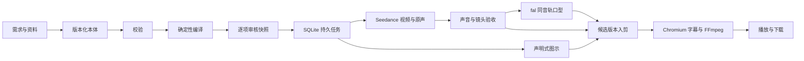

# 开发交接

## 架构

前端是 React 19／TypeScript／Vite，后端 Node 22／Express。业务数据使用 SQLite WAL，二进制媒体写入按 SHA-256 命名的内容目录。单进程串行处理重任务，不引入 Redis、图数据库、Blender 或旧服务依赖。

| 路径 | 职责 |
|---|---|
| `shared/types.ts`、`shared/ontology.ts` | 类型、运行时校验、规范哈希、依赖传播与编译 |
| `server/store.ts` | SQLite 表初始化、版本、审核、幂等记录、媒体和产物 |
| `server/jobs.ts` | 持久任务、提交意图、受理不明、恢复、依赖审核门禁 |
| `server/providers.ts` | Opus／Seedance／fal 网络边界与有效参考回执 |
| `server/media.ts`、`render-overlay.ts` | 同一帧时钟、图示、字幕、音轨、精确媒体合成 |
| `server/ingest.ts`、`archive.ts` | 资料解析、受限 ZIP、工程迁移与只读审稿导出 |
| `server/app.ts`、`main.ts` | 单管理员 API、Range、静态前端与生命周期 |
| `src/` | 四阶段编辑、关系图、制作图、审核和候选播放 |

数据库 `PRAGMA user_version=1`，首个迁移在 `server/migrations/001-init.sql`；全新启动即创建，也可停机运行 `npm run db:init`。添加 schema 版本时必须明确迁移，先备份，不能在启动时猜测或覆盖旧结构。工程修订不可原地覆盖，审核记录按 `(project,target,hash)` 保存。

## 恢复语义

- 未提交的任务：可以排队执行。
- 已持久化提交意图，尚无供应商 ID：重启后进入受理不明；禁止自动 POST。
- 有供应商 ID：始终复用原 ID 查询。下载或查询失败的重试不重发生成请求。
- 受理不明：由管理员到原供应商查找任务 ID，再在任务详情核对恢复；文本展开没有异步 ID 时保留不明记录，显式新提交前先核对账单与结果。
- 下游任务：等待前置任务成功并且产物人工通过。已审声音哈希绑定口型；撤回审核会阻止后续制作和合成。
- 新脚本生成条件发生变化：旧任务快照不能作为新内容继续提交。字幕修改保留原生成哈希，但旧的字幕/后期批准失效。
- Opus 返回时工程已经被用户修改：建议保留在任务中，由管理员明确应用，不覆盖当前草稿。

## 目前能力边界

运行的是结构化本体与可信执行器。没有 3D 导演台、骨骼动画或 DLSS；这些不属于本次独立医学审稿项目。动画图示支持文字、矩形、圆、箭头与淡入淡出，不执行模型返回的任意代码。风格丰富度可以在不放开代码执行的前提下扩展类型。

PDF/DOCX 提取文字并保留原文件，图片不自动转成医学证据；不提供自动 OCR。外部参考检索提供来源条目，下载和使用许可需人工核对后导入绑定。所有预览、资料与下载默认要求管理员登录；未来公开分享需单独设计只读发布快照，不能直接公开管理员 API。

生产域名仅提供配置模板。真实 Seedance、fal、Opus 调用、真实医生声音/嘴形和完整医学内容质量仍待部署后验收。此前项目的视频不作为新应用真实生成成功的证据。

## 下次开发建议

1. 从 GitHub 或源码 ZIP 开始，先运行 `npm ci`、`npm run doctor`、`npm run check`、`npm run test:ui`。
2. 创建独立数据目录；不要用旧视频工作台的数据库和服务凭据作为默认配置。
3. 在受控测试工程中配置实际供应商，先做一条短声音/视频与一条口型，核对原始回执和账单。
4. 导入获准使用的医生照片与资料，逐件检查来源及症状素材，审核后再制作完整 60 秒实片。
5. 分别记录代码通过、接口实测、医学审查、口型听感、公网部署验收；不要合并成一个“全部通过”。

运行命令和备份工具见部署文档。所有新代码应添加有意义的边界测试，尤其是新供应商的受理不明、重复请求与重启恢复。
