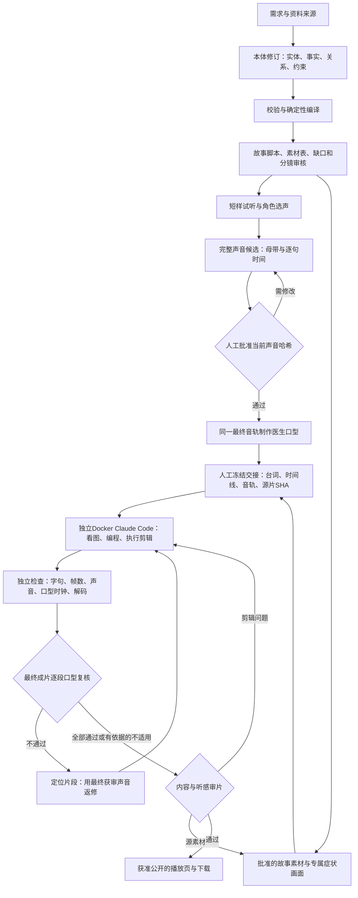

# 声音先行的故事视频工作流

v0.4.0 将已运行的制作流程作为后续影片的工作方法。用户认可工作流，不等于批准下一支片的脚本、声音或付费调用。此文描述应用能力和人工交接；不会自动创建任务，也不假装编辑器已经接入网页按钮。

## 每一步的实际交接

| 阶段 | 必须得到的产物 | 执行与审核位置 |
|---|---|---|
| 需求／本体 | 来源、创作设定、医学事实及依据；角色、物件、状态、关系；时长和画幅 | 应用项目修订、校验与编译；未知引用/缺口不能静默删除 |
| 脚本与资产 | 因果完整的故事、逐镜画面与声音、每个症状的专属素材；身份基准与实际首帧 | 应用审稿；展示图、通过候选、制作输入分别绑定 |
| 选声 | 同一文本的短样本、角色与音色选择、来源回执 | 供应商配置与操作者制作；不能把某片的试听选择自动应用于新片 |
| 完整声音 | 全文、母带、角色音轨、逐句时间、处理参数和 SHA-256 | 先试听最终速度，再明确批准该母带。应用支持声音产物审核；整片母带编排/记录由操作者交接，未新增专用自动母带审批接口 |
| 医生口型 | 五官清晰的批准照片及对应最终驱动音轨；任务与输入哈希 | 应用 fal／火山照片驱动适配器或明确记录的制作任务；更换声音不得继续使用旧嘴形 |
| 编辑器 | 冻结材料、私有交接单、输入清单、幂等键和输出合同 | 操作者显式提交 `ops/editor/worker.py` 任务；无应用数据库挂载，无自动提交桥 |
| 后期与验收 | 实际剪辑程序、时间线、字幕、影片、哈希和检查报告 | Claude Code 在隔离工具中执行；操作者另做独立检查，之后人审 |
| 最终口型复核 | 当前成片、获审母带与逐段声音绑定；每段口型结论、依据、返修项和审核人 | 合成后逐段人工检查最终画面与声音；返修后重新合成、重新复核。独立编辑器的私有复核记录不冒充应用中的新自动审批接口 |
| 公网交付 | 获准分享的影片、封面、简介及必要说明 | 操作者发布并验证匿名 HTTPS、播放、拖轴、Range、下载与手机布局；私有项目不自动公开 |

标准医学模板为60秒、25fps、1500帧、1080×1920；24fps的60秒片应为1440帧。项目可以选择其他规格，不能把某次影片的446字、五段医生或34条字幕硬编码为全局要求。

## 叙事与剪辑约束

故事先解释物件为什么出现、人物为什么行动、医生为什么进入。女主内心叙述承接经历，医生对患者的具体问题作回应；角色有性格，医学表达仍需准确。密集叙事优先删重复信息或调整获审稿件；未经明确同意不删台词、不截尾、不把两人说话叠在一起来凑时长。

如果确实选择保留全部文字并提速，先按真实音轨计算保音高变速，完整试听通过后冻结。口型使用最终速度的同一音轨；后期优先裁切镜头，不擅自再拉伸医生嘴形或更换音轨。源素材时长与入剪时长分开记录。

- 按语义切画面：手指、红斑、落发、溃疡应各有对应素材，不能拿另一个症状代替。医学示意图明确标识，不冒充病例照片。
- 场景变化、黑屏“一周后”等时间卡可以跨镜持续声音，避免为了换画面打断叙述。字幕按完整语义分句，避开嘴部与症状。
- 内心旁白下，优先使用闭嘴反应、手部和物件插镜；旧素材明显对口说话时应列缺口或更换获准片段。
- 景别／机位／动作状态先写入分镜。跨镜检查身份、服装、道具厚度与持有关系；重复关键动作时按动作点剪切，不靠转场掩盖物件突变。
- 配乐、音效、旁白按本项目明确需求处理。故事片的声音先行方案不改变产品默认“不自动加旁白”的规则。

## 冻结与提交

1. 在应用导出或私有制作目录中整理批准材料。使用 [交接模板](templates/EDITOR-BRIEF.md)，填写真实批准依据、哈希、输入限制和缺口，不复制旧片的批准记录。
2. 将要允许读取的文件逐个列在任务 `inputs`，相对输入根目录命名，计算实际 SHA-256。冻结母带、角色驱动音轨、分段时间线、字幕全文、源视频、源图及文字约束；参考图和真实视频分别标明。
3. 按 [编辑器指南](EDITOR-WORKER.md) 配置私有 secret 和只读素材目录，显式提交任务 JSON。编辑器会再次核对输入哈希、持久保存提交意图，单任务执行。任务合同要求实际程序、影片和报告；一句“已完成”不能过关。
4. 模型先用 FFmpeg 生成小尺寸 JPEG 检查图，实际读取，再编写和执行后期。9Router 原生路径硬上限96KiB，建议每张不超过64KiB；原始素材与成片分辨率不变。
5. 完成后独立验证并完成下述最终口型复核，使用 `export-reviewed` 导出到新的私有交接目录。主应用目前可导入片段候选，不提供独立编辑器的最终影片导入与自动审批接口；最终影片按明确公开范围交付，不直接覆盖应用审核、旧影片或数据库。

## 最后再对一遍嘴型

这一步发生在最终剪辑、变速、音轨拼接和字幕合成之后、正式发布之前。检查对象是准备交付的真实成片，不沿用源口型片段的通过结论。先冻结成片、最终获审母带、逐段时间线及各段驱动音轨的 SHA-256；每一段台词都必须在表中，包含角色、对白／内心独白／画外音、成片帧区间、源片与入点、速度及声音绑定。

1. 全片以1倍速连续看听，逐段核对声音来自哪位角色、台词是否一致、交接是否自然。再检查每个说话片段的首、中、尾、开口前与闭口后、剪辑切点两侧；必要时降速或逐帧定位。观察发音与开合嘴、停顿、表情和头部动作，不只看总时长。
2. 核对实际入点和速度，确认没有使用另一句或另一版音轨；检查裁切、手部、字幕和图示是否遮住嘴，以及切点是否截掉第一个或最后一个音节。医生源帧匹配、时间戳和音轨长度只证明素材与时钟关系，不能替代嘴形自然度的人审。
3. 每段记录“通过”“返修”或“不适用”的理由。内心独白／画外声确实没有可见说话口部时可以标“不适用”，仍须核对其画面与声音关系。女主明显张嘴说话却配内心独白是返修项，不能借“不适用”跳过；嘴被意外遮挡也不能当作已通过。
4. 不通过时记录准确帧区间、问题、建议修复及受影响输入。剪辑错位可调整入点；错误的嘴部动作需要用该段最终获审声音重新制作相应素材，再重新合成。若当前适配器输入只有照片与音频，产生的是新的人像口型片段，不能称为“保留原视频动作的局部口部修复”。是否使用视频驱动修复，以实际适配器与供应商回执为准。
5. 返修后的成片产生新哈希，重新覆盖全片逐段复核；旧记录保留，不移作新片批准。任何成片字节、母带、段落时间、声音绑定或复核范围变化，原复核都不能继续作为当前版本的发布凭据。尚有待审、返修或缺少说明的“不适用”项时不得发布为已通过成片。

这套复核本身不调用模型，也不自动创建付费返修任务。源片、人像重做、声音变化或全量重新口型仍遵循对应项目已明确的制作范围和费用边界。当前应用与独立编辑器仍由操作者冻结交接；新增的是最终复核步骤与可校验记录，不表示已接通网页自动返修或自动发布。

模型任务中禁止提供账号、环境文件、原始私有整库或不需要的个人资料。是否使用指定人物素材、上传哪个供应商、何时公开，依该项目已有授权判断。

## 变更、失败与恢复

| 变化 | 应重新做什么 | 可保留什么 |
|---|---|---|
| 字幕排版或时间卡 | 相关后期审核、局部重剪、最终检测及新成片口型复核（含遮嘴与切点） | 原视频、已批准声音与绑定口型 |
| 女主一句声音改变 | 完整声音重新听审，时间线及相关剪辑更新 | 未受影响源素材；不要伪造旧母带哈希 |
| 医生声音改变 | 该医生最终驱动音轨听审、对应口型与后期 | 其他医生已完成片段及其原任务 |
| 身份图／物件状态改变 | 沿本体真实引用重新审素材及关联镜头 | 历史候选与批准记录，不原地篡改 |
| 下载／编码失败 | 原供应商任务续查或本地重试相应阶段 | 已完成生成不重投 |
| 提交受理不明 | 查询原记录，人工核对供应商与会话 | 不自动新会话、不自动补跑或换模型 |
| 成片、母带、逐段时间线或声音绑定改变 | 新版本逐段口型复核；未通过前不发布 | 原复核作为历史证据，不转为新版本批准 |

编辑器的 `resume` 是显式续接原会话，会产生新的模型轮次，并非免费查询。应有相应授权依据，保留旧 attempt。任务完成后的文件变化标为产物无效，不悄悄重跑模型。

## 验收与已知实证

检查分三层：源码／模拟协议测试；真实模型和工具执行证据；人工内容验收。它们不可互相替代。最终以全文、逐句时间和母带核对字幕与声音，FFprobe 核对规格和精确帧数，完整解码检查损坏，抽查每镜首中尾和动作转折。医生源帧与驱动音轨匹配只能证明时钟与素材没有被错用，不能证明主观嘴形自然。

2026-10-13 V8.3 实例：Claude Code 经原生9Router实际读图、写程序和运行 FFmpeg；最终60秒、25fps、1500帧、1080×1920、H.264/AAC，13段声音、446字、34字幕全部保留，五段新医生口型用于成片。独立7项检查、医生源时钟检查及公网播放／下载验证通过。人物与物件连续性仍有已记录问题；用户本次认可工作流，不自动抹去这些审片问题。详细边界见 [验收记录](VERIFICATION.md) 和 [编辑器实测](EDITOR-WORKER.md)。

编辑器回传 `claude-opus-5-5` 与固定请求名称相符，是网关回执证据，不能独立证明底层供应商身份。当前工具不能直接听音频；音频统计和完整解码不能替代人耳试听。
